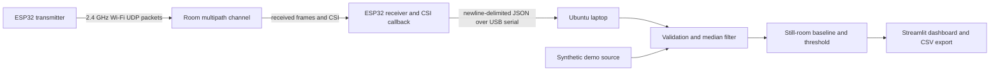
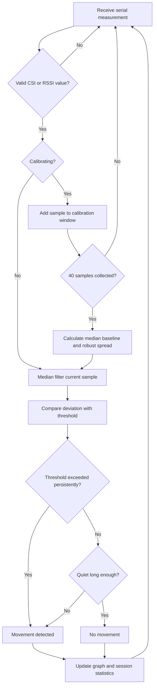

# Wi-Fi Radar: Real-Time Room Movement Detection and Visualization

## Abstract

This project demonstrates device-free room movement sensing using Wi-Fi Channel State Information (CSI). One ESP32 transmits periodic Wi-Fi packets and a second ESP32 receives them. The receiver extracts CSI from received frames and streams compact measurements to an Ubuntu laptop over USB serial. A Python application filters the signal, calibrates a still-room baseline, and detects sustained deviations. A Streamlit dashboard displays the signal, detection state, packet count, a radar-inspired sweep, and downloadable CSV measurements. A synthetic demonstration mode makes the interface usable before hardware is available. An RSSI-only receiver build is provided as a clearly labeled fallback. The system is a low-cost movement detector; it does not produce an image or an exact position estimate.

## Problem statement

Camera-based monitoring can collect visual information that is unnecessary for a simple movement alert. This project investigates whether changes in an ordinary Wi-Fi channel can reveal that motion occurred in a room, then presents those changes in an understandable dashboard. The target is a working educational prototype rather than a research-grade radar.

## Objectives

- Capture real Wi-Fi CSI from a receiver ESP32 when its chip and firmware support CSI.
- Stream timestamped measurements to the laptop through USB serial.
- Implement filtering, baseline calibration, threshold comparison, and a persistence rule.
- Display live measurements, sensor status, movement events, session duration, and CSV export.
- Provide a simulated mode and an RSSI-only fallback without disguising either as CSI.
- Explain radio propagation and the system's limits using a repeatable demonstration.

## Block diagram and architecture

The receiver creates a WPA2 SoftAP on channel 6 and uses the default AP address `192.168.4.1`. The transmitter joins the AP and sends a small UDP datagram every 100 ms. That traffic gives the receiver regular frames whose channel state can be sampled. The receiver's CSI callback does only a short amplitude calculation and queue insertion; a separate FreeRTOS task prints JSON, and the laptop handles visualization and detection. No external router is required.

## Working principle

At 2.4 GHz, a transmitted signal reaches the receiver over direct and reflected paths. People and objects in motion can change the multipath channel. CSI is a complex channel estimate for OFDM subcarriers. For subcarrier sample `k`, the firmware receives signed-byte imaginary and real components and computes magnitude `Aₖ = √(Iₖ² + Qₖ²)`. It summarizes the valid pairs as `A_RMS = √(Σ(Iₖ² + Qₖ²) / N)`. The resulting amplitude stream is compared with the room's calibrated baseline.

CSI amplitude is useful here because it retains more variation than RSSI's single received-power value. It is still affected by orientation, distance, channel traffic, antenna placement, and unrelated motion. The detector flags a sustained deviation; it does not infer an object identity or location.

## Wireless communication concepts

- **IEEE 802.11 Wi-Fi:** the boards communicate using 2.4 GHz Wi-Fi packets on a fixed channel.
- **OFDM:** Wi-Fi divides the channel into many narrow subcarriers. Each subcarrier may experience a different channel response.
- **CSI:** the receiver's channel estimate captures amplitude and phase information per subcarrier for a received packet. This project uses a scalar amplitude summary to keep the algorithm explainable.
- **RSSI:** received signal strength in dBm. The fallback records RSSI from captured data frames. It is not equivalent to CSI and has lower measurement detail.
- **Multipath and fading:** reflections can reinforce or cancel at the receiver; motion changes the paths and can change CSI amplitudes.
- **UART/USB serial:** measurement records are sent as UTF-8 newline-delimited JSON at 115200 baud from receiver to laptop.

## Hardware and software requirements

**Hardware:** two original ESP32 boards using ESP-WROOM-32 modules, two data-capable USB cables that fit the boards, Ubuntu laptop. One board receives power and is connected to the laptop during collection; the transmitter only needs power after flashing. The user has purchased one WROOM-32 board, so a second compatible board is needed for the complete two-endpoint prototype.

**Software:** ESP-IDF 5.4.4 targeting the original `esp32`; Python 3.10+; NumPy, SciPy, pandas, Matplotlib, Streamlit, and pySerial. Full purchase and setup details are in the project [README](../README.md).

## Algorithm

1. Read one JSON line and validate its mode and finite measurement fields.
2. Apply a trailing 5-sample median filter to reject isolated spikes.
3. During calibration, collect 40 still-room measurements and calculate the median baseline `μ` and scaled median absolute deviation `σᵣ`.
4. Calculate the configured threshold `T = max(sensitivity × σᵣ, noise floor)`.
5. Set movement when at least three consecutive filtered samples satisfy `|x - μ| > T`.
6. Clear movement after five consecutive samples return within the threshold.
7. Log the sample, baseline, threshold, and state for session export.

The RSSI mode uses the same steps with dBm as `x` and a higher minimum threshold floor. The threshold multiplier is configurable; lower sensitivity settings can produce more false alerts.

### Flowchart

## Implementation details

- **Firmware:** two ESP-IDF applications for the original ESP32. The receiver uses the classic ESP32 CSI configuration, runs SoftAP and promiscuous capture, filters frames to the transmitter's fixed MAC, calculates RMS CSI amplitude, queues records, and emits JSON over UART. Its menuconfig option builds an RSSI-only promiscuous packet callback. The transmitter reconnects to the receiver AP and periodically sends UDP datagrams.
- **Python collection:** a background thread reads serial or generates deterministic-rate synthetic data; a bounded queue keeps the dashboard responsive.
- **Signal processing:** SciPy median filtering and median absolute deviation; NumPy handles finite-value checks and rolling medians.
- **Movement state:** configurable multiplier, 3-sample onset persistence, 5-sample release, no uncalibrated confidence score.
- **Dashboard:** dark styling, live graph, status cards, rotating radar-style sweep, movement marker, calibration control, sensitivity slider, start/stop, and CSV export.
- **Data format:** each serial measurement is one JSON line with `type`, `seq`, `t_us`, and CSI amplitude/RSSI fields. Device timestamp is monotonic microseconds since boot; laptop arrival time is used to chart the session.

## Testing methodology and current results

The automated unit tests exercise median filtering, robust baseline statistics, minimum calibration samples, movement onset/release persistence, and malformed serial data rejection. The demonstration source generates stable baseline noise and scheduled signal deviations so the dashboard can be checked without RF boards.

The user has purchased one ESP32-WROOM-32 development board. The complete prototype requires a second compatible board. This workspace has no ESP-IDF command or attached serial devices, so firmware compilation and RF/hardware results remain to be collected. Unit tests validate Python behavior only. Do not report simulated measurements as physical measurements. For the final report after the live trial, record board module markings, ESP-IDF version, room dimensions, board separation, packet count, baseline spread, threshold, observed events, false detections, and missed detections.

## Expected observations and limitations

In a still room after calibration, the state should remain **NO MOVEMENT** and the graph should fluctuate around baseline. Walking through the transmitter/receiver path should change the measured channel and may trigger **MOVEMENT DETECTED**. A stable result depends on board placement and ambient traffic; this must be demonstrated with the purchased hardware.

Limitations:

- The radio path is a single sensing link, so the project cannot show a measured point or heatmap location.
- CSI amplitude thresholding may flag movement outside the intended path or miss small movements.
- A fixed threshold can need recalibration after moving a board, changing the room, or changing channel traffic.
- RSSI mode is a lower-detail fallback and may be less reliable than CSI.
- USB serial, Wi-Fi callback rates, board clone layouts, antennas, and ESP-IDF configuration vary.
- No physical hardware test has yet been performed.

## Applications

Educational wireless sensing, room activity indication, privacy-preserving coarse movement alerts, and experiments in radio propagation/multipath. A real deployment would need careful validation and a clear consent/privacy policy.

## Why this is a wireless technology project

The sensing variable is the Wi-Fi radio channel itself. The prototype configures an IEEE 802.11 link, sends 2.4 GHz packets, obtains CSI/RSSI from the receiver's Wi-Fi hardware, and studies how multipath changes under motion. The project therefore combines wireless PHY/channel concepts with embedded Wi-Fi firmware, serial telemetry, and software signal processing; the dashboard is the visualization layer for those wireless measurements.

## Future scope

- Compare multiple CSI subcarrier features instead of one RMS amplitude.
- Add adaptive threshold review and day-to-day calibration storage.
- Test different frequencies, bandwidth settings, and antenna placements.
- Use multiple synchronized receivers for spatial experiments, while documenting the added clock and calibration complexity.
- Add a formal dataset and evaluate sensitivity, specificity, false positives per hour, and missed-event rate.

## Conclusion

Wi-Fi CSI provides a practical way to observe changes in a radio channel without a camera or wearable. This project turns that principle into an understandable sender/receiver prototype, Python detector, and live dashboard. Its intended result is coarse movement detection, not imaging or localization. The simulator allows the interface and algorithms to be demonstrated now; physical CSI performance and the firmware build still require verification with the selected ESP32 boards.

## References

See the linked technical sources in [hardware research](hardware_research.md#technical-references-and-project-survey). Primary references include Espressif's ESP-IDF ESP32 Wi-Fi CSI guide and the target-specific `esp-csi` sender/receiver examples.
